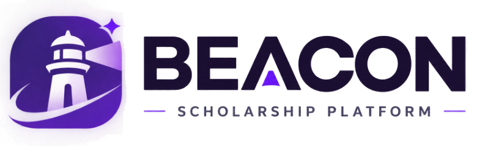
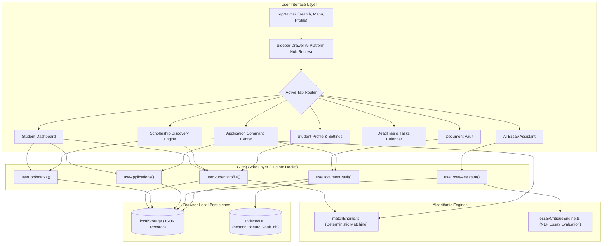
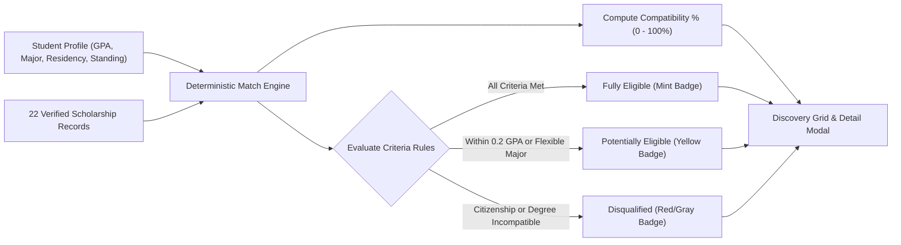
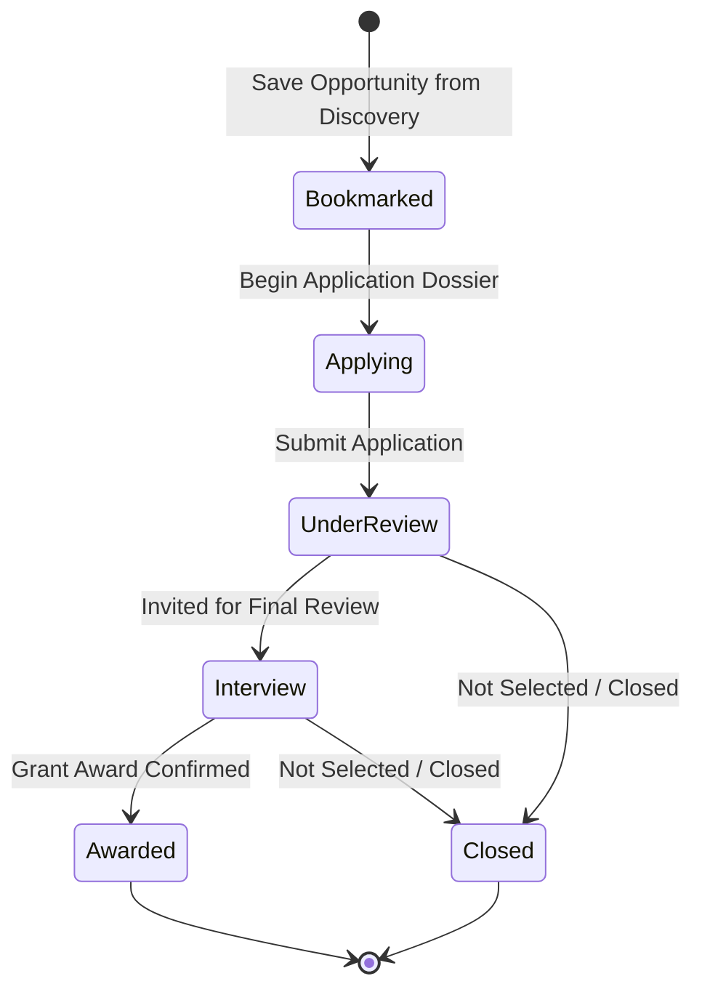
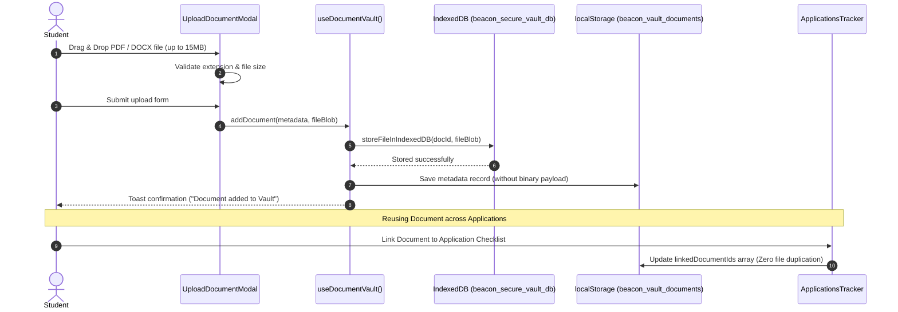

# BEACON — Unified Scholarship Discovery & Management Platform

<p align="center">
  
</p>

<p align="center">
  <strong>A deterministic, student-centered command center for discovering, qualifying, tracking, and securing higher education funding.</strong>
</p>

<p align="center">
  
  
  
  
  
  
  
</p>

---

## 1. Project Introduction

### The Problem
Finding and applying for higher education scholarships is traditionally an opaque, high-friction process:
- Opportunities are scattered across hundreds of disparate portals with inconsistent formatting.
- Eligibility requirements (GPA cutoffs, residency, major specifications) are buried in dense legal text.
- Students must repeatedly re-upload the same transcripts, essays, and letters of recommendation across different applications.
- Deadlines and tasks are easily lost across messy spreadsheets and email threads.

### The Solution: BEACON
**BEACON** is a unified, client-first web application designed to empower students throughout the entire scholarship lifecycle. Built on a distinctive **Playful Geometric Light System**, BEACON combines deterministic criteria matching, a centralized multi-application document vault, a visual Kanban pipeline, deadline task tracking, and an interactive essay critique workshop into a single cohesive interface.

---

## 2. Key Features

### 🎓 1. Student Dashboard & Intelligence Hub
- **Dynamic Welcome Banner**: Displays current scholar standing (e.g., Computer Science & AI Scholar at MIT), verified GPA, and personalized match boost alerts.
- **Funding Trajectory Cards**: Real-time calculated counters separating **Opportunities Discovered** (22 records), **Eligible Matches** (18 qualified), **Active Applications** (4 active), and **Upcoming Deadlines** (5 tracked, 2 urgent).
- **Target Funding Pool**: Visualizes pursued funding (\$135,500 across active applications) versus awarded capital.
- **Live Pipeline Progress**: Stage-by-stage status checkpoints and document dossier completeness bars.

### 🔍 2. Scholarship Discovery & Search Engine
- **Deterministic Match Score**: Every opportunity features a computed percentage compatibility score (e.g., 100%, 94%, 88%) evaluated directly against the active student profile.
- **Transparent Criteria Breakdowns**: Modal breakdown shows exact satisfying conditions (Education Level, Minimum GPA, Field of Study, Residency) and reasons for potental disqualifications.
- **Full-Text Live Search**: Instant search filtering across scholarship titles, awarding organizations, target fields, and descriptions.

### 🏷️ 3. Multi-Category Filtering, Sorting & Bookmarks
- **Eligibility Status Toggles**: Single-click filtering between *All Statuses*, *Eligible Only*, *Potentially Eligible*, and *Disqualified*.
- **Discipline Categories**: Filter by *STEM*, *Merit*, *Research*, *Diversity*, and *Leadership*.
- **Multi-Field Sorting**: Sort by *Highest Match*, *Submission Deadline*, and *Grant Award Amount*.
- **Portfolio Bookmarks**: One-click bookmark toggle with real-time portfolio counter and persistent storage.

### 👤 4. Student Profile & Deterministic Eligibility Engine
- **Academic Profile Editor**: Update GPA, Class Standing, Major/Track, Institution, Expected Graduation Date, State/Country Residency, and Pell Grant eligibility.
- **Real-Time Match Engine**: Implemented in [`src/utils/matchEngine.ts`](file:///c:/Users/testp/Desktop/PROJECTS/BEACON/src/utils/matchEngine.ts), evaluating criteria sets deterministically without black-box heuristics.
- **Skill & Certification Dossier**: Tag-based entry for verified student competencies, technical skills, and academic honors.

### 📋 5. Application Command Center & Kanban Board
- **Dual View Modes**: Switch seamlessly between a high-density **Table Tracker** and an interactive visual **Kanban Board**.
- **Lifecycle Stages**: Track opportunities across 5 pipeline stages:
  1. `Bookmarked` (Prospects)
  2. `Applying` (Dossier assembly)
  3. `Under Review` (Submitted to committee)
  4. `Interview` (Final evaluation)
  5. `Awarded` / `Closed`
- **Application Detail Dossier**: View submission milestones, checklist requirements, linked vault documents, notes, and direct portal links.
- **Fast-Track Application Modal**: Manually log external scholarships or link existing discovery listings directly into the pipeline.

### 📅 6. Deadlines & Tasks Calendar
- **Chronological Calendar Grid**: Dual-month view with highlighted deadlines and priority urgency indicators.
- **Actionable Task Checkpoints**: Break down application requirements into actionable tasks with due dates and priority tags (*Critical*, *High*, *Medium*).
- **Interactive Checkbox Persistence**: Toggle task completion with visual strikethrough and instant state persistence.

### 🗄️ 7. Centralized Document Vault
- **Client-Side Binary File Uploads**: Upload transcripts, IDs, resumes, letters, and statements (supports PDF, DOC, DOCX, PNG, JPG up to 15 MB).
- **IndexedDB Binary Storage**: Implemented via [`src/utils/indexedDBStorage.ts`](file:///c:/Users/testp/Desktop/PROJECTS/BEACON/src/utils/indexedDBStorage.ts) to store raw file `Blob` instances locally without localStorage quota limits.
- **Multi-Application Reusability**: Link a single uploaded document to multiple scholarship applications without duplicating the stored binary file.
- **Management Operations**: Rename documents, preview metadata in a secure viewer, download stored files, and delete records with confirmation safeguards.

### ✍️ 8. AI Essay Assistant & Workshop
- **Deterministic Critique Engine**: Implemented in [`src/utils/essayCritiqueEngine.ts`](file:///c:/Users/testp/Desktop/PROJECTS/BEACON/src/utils/essayCritiqueEngine.ts) to evaluate essays using rule-based NLP algorithms.
- **Multi-Dimensional Scoring**: Computes objective scores (0–100) across:
  - *Thesis & Argument Clarity*
  - *Prompt Alignment & Specificity*
  - *Structure & Coherence*
  - *Academic Tone & Vocabulary Diversity*
- **Live Metrics**: Real-time word count tracking against minimum/maximum prompt limits and reading time estimation.
- **Draft Version History**: Save multiple draft versions locally and restore previous iterations.

### 📊 9. Analytics & Financial Overview
- **Funding Distribution Charts**: Recharts-powered bar graphs visualizing pursued funding by discipline and application stage.
- **Readiness Trajectory Metric**: Aggregated institutional readiness score across active applications.

---

## 3. Technology Stack

| Layer | Technology | Version | Purpose |
| :--- | :--- | :--- | :--- |
| **Runtime / Library** | React | `^19.3.1` | Core declarative UI component model |
| **Language** | TypeScript | `^7.0.2` | Strict static typing and interface contracts |
| **Build Tool / Bundler**| Vite | `^8.3.6` | Fast ESM development server and optimized Rollup production builds |
| **CSS Framework** | Tailwind CSS v4 | `^4.3.5` | Next-generation CSS framework with `@tailwindcss/vite` |
| **Animation Engine** | Framer Motion | `^14.10.1` | Declarative spring animations, slide-in drawers, and modal transitions |
| **Iconography** | Lucide React | `^1.70.0` | Crisp, scalable geometric icons |
| **Data Visualization** | Recharts | `^3.10.1` | Responsive SVG bar charts and analytics graphs |
| **Binary File Storage**| IndexedDB | Native Web API | Client-side blob storage for Document Vault files (`beacon_secure_vault_db`) |
| **Key-Value Storage** | localStorage | Native Web API | Client-side persistence for profile, applications, tasks, and drafts |
| **Browser Testing** | Puppeteer Core | `^25.16.0` | Headless Chrome automated verification and visual regression testing |

---

## 4. Visual Preview & Screenshots

The application follows the **Playful Geometric Light System**: warm cream backgrounds (`#fffdf5`), crisp white cards (`#ffffff`), dark ink text (`#253044`), bold outlines (`#252b3a`), deep violet buttons (`#6434df`), and pastel geometric accents (mint `#9bf1cd`, yellow `#ffd05b`, pink `#ff78c5`).

### Desktop Dashboard with Collapsible Sidebar Closed (Default State)
The sidebar remains closed on load, granting the main content area full container width:


### Desktop Left-Side Drawer Open
Clicking the top navigation menu button opens the slide-in drawer over a subtle backdrop:


### Scholarship Discovery Engine
Filterable catalog with live criteria matching and portfolio bookmarking:


### Scholarship Transparent Eligibility Breakdown Modal
Detailed breakdown showing satisfied criteria and application tracker action:


### Responsive Mobile Navigation Drawer (390px Viewport)
Touch-friendly full-height slide-in drawer with background scroll locking:


---

## 5. Architecture & Workflows

### Overall Application Architecture



### Scholarship Discovery & Deterministic Match Workflow



### Application Pipeline & Command Center Workflow



### Document Vault & IndexedDB Storage Workflow



---

## 6. Installation & Setup

### Prerequisites
- **Node.js**: v18.0.0 or higher
- **npm**: v9.0.0 or higher
- Modern Chromium, Firefox, or Safari browser

### 1. Clone the Repository
```powershell
git clone https://github.com/your-username/BEACON.git
cd BEACON
```

### 2. Install Dependencies
```powershell
npm install
```

### 3. Start Development Server
```powershell
npm run dev
```
The application will launch locally at `http://localhost:5175/` (or next available port).

### 4. Build for Production
```powershell
npm run build
```
Executes TypeScript compilation (`tsc -b`) followed by the Vite production bundle (`vite build`). Output assets are generated in the `/dist` directory.

### 5. Preview Production Build
```powershell
npm run preview
```
Serves the compiled production bundle locally to verify asset loading, chunking, and routing.

---

## 7. Data Persistence & Privacy Limitations

### What is Stored in `localStorage`
- **Student Profile**: Basic personal info, GPA, major, academic year, and residency (`beacon_student_profile`).
- **Application Pipeline**: All application records, custom notes, checklists, and pipeline stages (`beacon_applications_data`).
- **Bookmarks**: Array of saved scholarship opportunity IDs (`beacon_bookmarked_ids`).
- **Document Metadata**: Titles, categories, file names, upload timestamps, and linked application IDs (`beacon_vault_documents`).
- **Essay Workshop**: Saved essay drafts, target prompt links, and revision history (`beacon_essay_history`).

### What is Stored in `IndexedDB`
- **Raw Document Files**: Uploaded binary blobs (PDFs, images, DOCX files) are stored in an IndexedDB database named `beacon_secure_vault_db` under the `vault_files` object store. This prevents browser `localStorage` quota overflow (which typically caps at 5 MB).

### Important Security & Privacy Limitations
1. **Device-Local Only**: All data resides strictly inside the user's browser sandbox. Information does **not** synchronize across different devices or browsers.
2. **No Cloud Transmission**: No student profiles, essays, or academic documents are transmitted to remote servers or third-party APIs.
3. **Unencrypted at Rest**: Browser-local storage (`localStorage` and `IndexedDB`) is stored in unencrypted format. On shared computers (e.g. public lab computers), users should clear browser data or reset demo state before closing their session.

---

## 8. Project Structure

```text
BEACON/
├── public/
│   ├── beacon-icon.png               # Standalone 256x256 lighthouse brand emblem
│   ├── beacon-logo.png               # Full horizontal brand logo (transparent alpha)
│   ├── favicon.ico                   # Multi-size browser tab favicon
│   └── favicon.svg                   # Vector fallback icon
├── src/
│   ├── components/
│   │   ├── applications/             # Application Command Center & Kanban components
│   │   │   ├── AddApplicationModal.tsx
│   │   │   ├── ApplicationDetailModal.tsx
│   │   │   └── ApplicationsTracker.tsx
│   │   ├── assistant/                # AI Essay Assistant workshop & critique editor
│   │   │   └── AiEssayAssistant.tsx
│   │   ├── dashboard/                # Main student dashboard widgets
│   │   │   ├── ApplicationProgress.tsx
│   │   │   ├── RecommendationSection.tsx
│   │   │   ├── ScholarshipCard.tsx
│   │   │   ├── StatCards.tsx
│   │   │   ├── UpcomingDeadlines.tsx
│   │   │   └── WelcomeBanner.tsx
│   │   ├── deadlines/                # Calendar and task management views
│   │   │   └── DeadlinesCalendarView.tsx
│   │   ├── discovery/                # Scholarship search, filter, and detail views
│   │   │   └── ScholarshipDiscoveryEngine.tsx
│   │   ├── layout/                   # Global layout and navigation
│   │   │   ├── MobileNav.tsx         # Mobile drawer re-export
│   │   │   ├── Sidebar.tsx           # Collapsible slide-in drawer (hidden by default)
│   │   │   └── TopNavbar.tsx         # Top bar with menu trigger, brand, and search
│   │   ├── modals/                   # Global dialogs and dropdowns
│   │   │   ├── NotificationsDropdown.tsx
│   │   │   ├── ProfileDropdown.tsx
│   │   │   └── ScholarshipDetailModal.tsx
│   │   ├── profile/                  # Student profile and criteria configuration
│   │   │   └── StudentProfilePage.tsx
│   │   ├── ui/                       # Reusable UI primitives
│   │   │   ├── Badge.tsx
│   │   │   └── Toast.tsx
│   │   └── vault/                    # Document Vault file upload, preview, and linking
│   │       ├── AttachToApplicationModal.tsx
│   │       ├── DocumentPreviewModal.tsx
│   │       ├── DocumentVault.tsx
│   │       ├── RenameDocumentModal.tsx
│   │       └── UploadDocumentModal.tsx
│   ├── data/                         # Verified demonstration records & models
│   │   ├── essayPromptsData.ts       # Common scholarship essay prompts
│   │   ├── initialApplications.ts    # Seed application pipeline records
│   │   ├── mockData.ts               # Seed statistics and profile metrics
│   │   ├── scholarshipDatabase.ts    # 22 verified demonstration scholarships
│   │   ├── userData.ts               # Default MIT scholar profile
│   │   └── vaultData.ts              # Seed verified document records
│   ├── hooks/                        # Persistent custom React hooks
│   │   ├── useApplications.ts        # Pipeline state & funding analytics
│   │   ├── useBookmarks.ts           # Bookmark toggle & persistence
│   │   ├── useDocumentVault.ts       # Vault metadata & IndexedDB synchronization
│   │   ├── useEssayAssistant.ts      # Essay draft revisions & scores
│   │   └── useStudentProfile.ts      # Profile validation & criteria state
│   ├── types/                        # Core TypeScript interfaces & types
│   │   └── index.ts
│   ├── utils/                        # Algorithmic calculation engines & storage utilities
│   │   ├── essayCritiqueEngine.ts    # Deterministic NLP essay critique engine
│   │   ├── indexedDBStorage.ts       # IndexedDB binary Blob storage wrapper
│   │   └── matchEngine.ts            # Deterministic scholarship eligibility evaluator
│   ├── App.tsx                       # Root application shell & tab routing
│   ├── index.css                     # Tailwind CSS v4 directives & light theme tokens
│   ├── main.tsx                      # React DOM root entry point
│   └── vite-env.d.ts                 # Vite client type declarations
├── index.html                        # HTML5 document template & light theme lock
├── package.json                      # Project dependencies & build scripts
├── tsconfig.json                     # TypeScript compiler options
├── vercel.json                       # Vercel deployment rewrites & security headers
└── vite.config.ts                    # Vite plugins & manual chunk splitting
```

---

## 9. Deployment

### Vercel Deployment Workflow
The project is configured for single-command deployment to **Vercel** with SPA client-side routing and security headers pre-configured in [`vercel.json`](file:///c:/Users/testp/Desktop/PROJECTS/BEACON/vercel.json):

```json
{
  "framework": "vite",
  "buildCommand": "npm run build",
  "outputDirectory": "dist",
  "cleanUrls": true,
  "rewrites": [
    {
      "source": "/(.*)",
      "destination": "/index.html"
    }
  ],
  "headers": [
    {
      "source": "/(.*)",
      "headers": [
        { "key": "X-Content-Type-Options", "value": "nosniff" },
        { "key": "X-Frame-Options", "value": "DENY" },
        { "key": "Referrer-Policy", "value": "strict-origin-when-cross-origin" }
      ]
    },
    {
      "source": "/assets/(.*)",
      "headers": [
        { "key": "Cache-Control", "value": "public, max-age=31536000, immutable" }
      ]
    }
  ]
}
```

#### Deploy via Vercel CLI
```powershell
npm install -g vercel
vercel
```

#### Deploy via GitHub Integration
1. Push this repository to GitHub.
2. In the Vercel Dashboard, select **Add New Project** and import the repository.
3. Keep default settings:
   - **Framework Preset**: `Vite`
   - **Build Command**: `npm run build`
   - **Output Directory**: `dist`
4. Click **Deploy**.

---

## 10. Planned Improvements

The following items are planned enhancements:

- [ ] **Cloud Synchronization**: Optional encrypted cloud sync (e.g. Supabase or Firebase Auth) for multi-device access.
- [ ] **Client-Side File Encryption**: Web Crypto API (AES-GCM) encryption for IndexedDB document files and sensitive profile fields.
- [ ] **LLM Essay Feedback Integration**: Optional connection to OpenAI / Google Gemini API for contextual feedback alongside the rule-based critique engine.
- [ ] **PDF Export Engine**: Generate printable application dossier summaries and deadline reports for academic advisors.
- [ ] **Institutional Webhooks**: Direct integration with university financial aid management portals.

---

## 11. Project Status & Contribution

### Status
- **Current Version**: `v2.4`
- **Quality Audit**: Passed all competition-readiness checks, technical audits, and visual accessibility reviews.
- **Theme**: Strict Playful Geometric Light System (zero dark surfaces, darkreader-locked).

### Contribution
Contributions, bug reports, and suggestions are welcome.
1. Fork the repository.
2. Create your feature branch (`git checkout -b feature/AmazingFeature`).
3. Commit your changes (`git commit -m 'Add some AmazingFeature'`).
4. Push to the branch (`git push origin feature/AmazingFeature`).
5. Open a Pull Request.

### License
Licensing terms for this project should be confirmed with the repository maintainers prior to commercial redistribution.

---

<p align="center">
  <strong>BEACON Scholarship Platform</strong> • Empowering Scholars Worldwide
</p>

